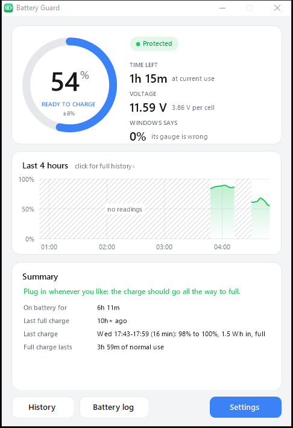
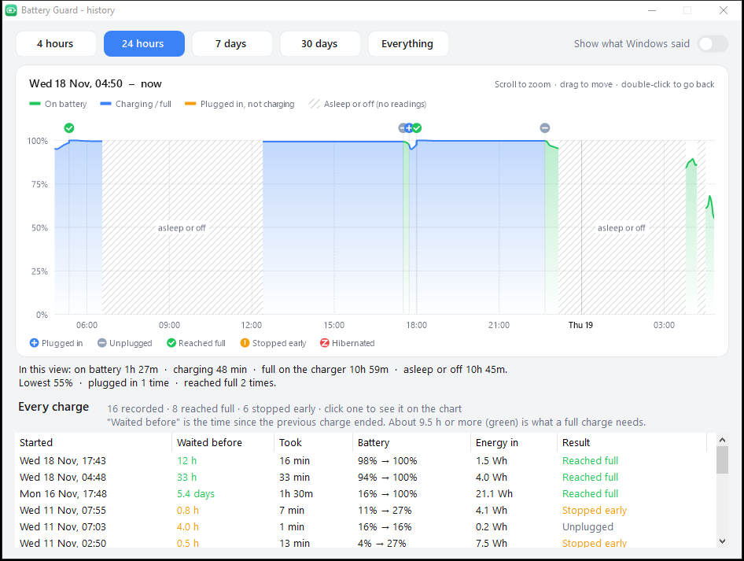
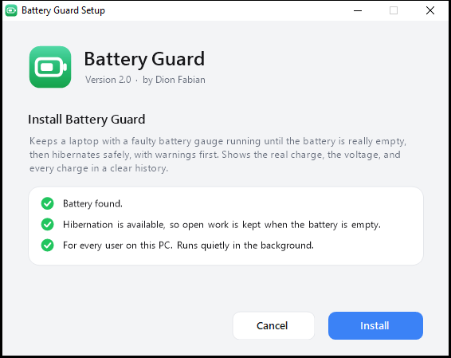
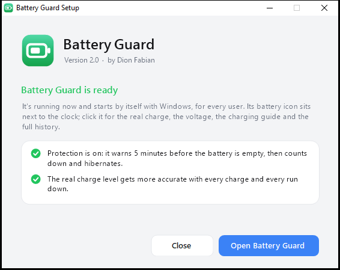
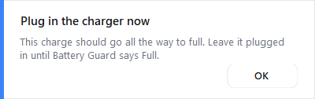

<p align="center">
  
</p>

<h1 align="center">Battery Guard</h1>

<p align="center">
  <b>Keeps a Windows laptop with a faulty battery gauge running until the battery is really empty, then hibernates safely, with warnings first.</b><br>
  Shows the real charge, the voltage, and every charge in a clear, interactive history.
</p>

<p align="center">
  <a href="https://github.com/pacificdion/battery-guard/releases/latest"></a>
  <a href="LICENSE"></a>
  
  
</p>

<p align="center">
  <a href="https://github.com/pacificdion/battery-guard/releases/download/v2.0/BatteryGuard-Setup-2.0.exe"><b>&#11015; Download BatteryGuard-Setup-2.0.exe</b></a>
  &nbsp;·&nbsp; <a href="#install">How to install</a>
  &nbsp;·&nbsp; <a href="#uninstall">Uninstall</a>
  &nbsp;·&nbsp; <a href="https://github.com/pacificdion/battery-guard/issues">Report a problem</a>
</p>

---

## Contents

- [The problem it solves](#the-problem-it-solves)
- [What it does](#what-it-does)
- [Screenshots](#screenshots)
- [Requirements](#requirements)
- [Install](#install)
- [Using Battery Guard](#using-battery-guard)
- [Settings](#settings)
- [How it works](#how-it-works)
- [Where things are stored](#where-things-are-stored)
- [Uninstall](#uninstall)
- [Build it yourself](#build-it-yourself)
- [Troubleshooting](#troubleshooting)
- [Safety and privacy](#safety-and-privacy)
- [License](#license)

## The problem it solves

Many replacement (aftermarket) laptop batteries have a **wrong charge gauge**. The battery itself is fine, but its chip thinks it holds far less than it does, for example 4 Wh instead of 34 Wh. Windows trusts that chip, so:

- it shows **0% and "critical battery" about 25 minutes after unplugging**, while most of the charge is still there;
- it **hibernates or shuts down hours too early**;
- Battery Saver switches itself on almost immediately;
- the charger often **stops early**, because the battery tells it it's already full.

Battery Guard ignores the wrong percentage and watches the **battery's real voltage** instead.

## What it does

- **Runs until the battery is really empty.** It switches off Windows' early "critical battery" action and decides by the voltage of each cell.
- **Warns you, then hibernates safely.** A notice comes about 5 minutes before empty, then a 60-second countdown, then the laptop hibernates so your open work is kept. One "+2 min" postpone is allowed, and plugging in cancels it.
- **Shows the real charge** in the tray as a battery icon with the percentage inside, and in a dashboard with time left, voltage, charge power and what Windows wrongly claims.
- **Learns your battery.** Every run-down and every full charge makes the percentage and time-left more accurate.
- **Detects a charger that stops early**, predicts when a charge will stop short, and tells you when the next full charge is possible. It only does this on PCs where it has actually seen the charger stop early.
- **Keeps a complete history**: an interactive chart (hover, zoom, drag), every charge with how long it took and how it ended, and a full CSV log.
- **Works for every user on the PC**, on the lock screen and with nobody signed in. It runs as a small Windows service.
- **Light**: the service uses about 2–3 MB of memory, the tray app about 12 MB and well under a second of CPU per hour. It has no internet access and no telemetry.

## Screenshots

| Dashboard | History |
|---|---|
|  |  |

**Tray icon** (charging · full · on battery · low · plugged in but not charging · hibernating soon):


| Installer | Done | A notice |
|---|---|---|
|  |  |  |

## Requirements

- A **laptop** running **Windows 10 or 11** (Windows 7 and 8.1 should work but are untested).
- **.NET Framework 4.x**, which is built into Windows 10 and 11. Older Windows: [download .NET Framework 4.8](https://dotnet.microsoft.com/download/dotnet-framework/net48).
- **Administrator rights once**, to install.
- **Hibernation** available. The installer turns it on if it's off. On PCs that can't hibernate, Battery Guard shuts down safely instead.

Tested on a Dell Inspiron 5521 (Windows 10 22H2) with a 3-cell aftermarket battery.

## Install

1. **Download** [`BatteryGuard-Setup-2.0.exe`](https://github.com/pacificdion/battery-guard/releases/download/v2.0/BatteryGuard-Setup-2.0.exe) from the [latest release](https://github.com/pacificdion/battery-guard/releases/latest).
2. **Run it.** The installer isn't code-signed, so Windows SmartScreen may say *"Windows protected your PC"*. Click **More info** → **Run anyway**.
3. Click **Yes** on the administrator (UAC) prompt.
4. Check the short summary (battery found, hibernation available) and click **Install**. It takes a few seconds.
5. Click **Open Battery Guard**. From now on its battery icon sits next to the clock for every user. If you can't see it, click the **^** arrow and drag it onto the taskbar.

**Optional: check the download.** In PowerShell, run:

```powershell
Get-FileHash "$env:USERPROFILE\Downloads\BatteryGuard-Setup-2.0.exe" -Algorithm SHA256
```

The hash should match the SHA-256 listed in the [release notes](https://github.com/pacificdion/battery-guard/releases/latest).

**Silent install** (for scripts or several PCs), from an administrator prompt:

```powershell
.\BatteryGuard-Setup-2.0.exe /S
```

**Updating:** run a newer setup file. Settings, history and everything it has learned are kept.

## Using Battery Guard

| | |
|---|---|
| **Tray icon** | The real charge inside a battery. Green: charging or full. White: on battery. Red: 20% or less, or hibernating soon. Amber: plugged in but not charging. A "–": the service isn't running. Hover for the voltage and time left; click to open the dashboard. |
| **Dashboard** | Real charge (with its accuracy), time left at the current use, voltage per pack and per cell, what Windows claims, the last 4 hours, and advice on what to do now. Click the chart for the full history. |
| **History** | Choose 4 hours to Everything. **Hover** for the details at any moment, **scroll** to zoom, **drag** to move, **double-click** to go back. Hatched areas mean asleep or off. Click a charge in the list to jump to it. |
| **Battery log** | Opens a copy of the full CSV log, one line every 10–60 seconds, in Excel or any editor. |
| **Warnings** | About 5 minutes before empty: a notice. At about 1 minute: a countdown, then hibernation. Plug in at any time to cancel. |
| **Charging guide** | Only on PCs whose charger stops early: it says when a charge will stop short, how long to wait, and when to unplug and plug in for a full charge. |

You can also open the dashboard from **Start menu → Battery Guard**.

## Settings

Open the dashboard and click **Settings**. These apply to every user on the PC, except *Show the tray icon*.

| Setting | Default | What it means |
|---|---|---|
| Battery protection | On | Off gives control back to Windows' own (wrong) battery rules. |
| Hibernate at | 3.50 V per cell | *Extra safe* 3.55 V · *Balanced* 3.50 V · *Longest runtime* 3.42 V. Lower runs longer. |
| Warn me | 5 min | How long before hibernating the warning appears (1–30). |
| Countdown | 60 s | How long the countdown stays on screen (15–300). |
| Allow one "+2 min" | On | One postpone during the countdown. |
| Hide Windows' warnings | On | Windows' low-battery pop-ups are wrong for these batteries. |
| Show the tray icon | On | Per user. Protection stays on either way. |
| Reset learning | – | Forgets the learned runtime curve, capacity and safety limit. |

If the battery ever cuts out before the safety limit, Battery Guard notices at the next start-up and raises the limit by itself.

## How it works

- **Voltage, not the gauge.** It reads the battery's voltage straight from the Windows battery driver every 10 seconds on battery, every second during a countdown, and less often on the charger. It compares the median voltage per cell with the safety limit, and hibernation is decided by voltage alone.
- **A learned "time left" curve.** The percentage and time left come from a curve of "minutes of normal use left" against voltage. It starts from a curve measured on a real 3-cell battery, is stretched to your laptop's runtime the first time it runs down, and is refined after every run down to the limit. While charging it counts the energy going in, using the charge power, which these batteries do report correctly.
- **A charger that stops early.** If the charger stops while the real charge is low but the battery reports itself full, Battery Guard records it. From then on it predicts each charge and learns what a full charge needs on that PC. On the battery it was developed on, that was about 9.5 hours since the previous charge and a little energy used.
- **A Windows service, not a scheduled task.** Windows turns Battery Saver on early when the gauge is wrong, and while Battery Saver is on, Task Scheduler holds back background tasks. A service always runs. It starts at boot, Windows restarts it within seconds if it ever fails, and it saves everything before Windows shuts down.
- **Two small programs.** `BatteryGuardCore.exe` is the service (SYSTEM). `BatteryGuard.exe` is the tray app, one per signed-in user. The service starts the tray apps and writes `status.ini`. The tray apps react to it instantly and send requests through a locked-down inbox folder.

## Where things are stored

| Location | What's there |
|---|---|
| `C:\Program Files\BatteryGuard\` | The programs and `uninstall.exe` |
| `C:\ProgramData\BatteryGuard\settings.ini` | Settings |
| `C:\ProgramData\BatteryGuard\battery-log.csv` | Every reading: `time_utc, on_ac, charging, charge_state, pack_mv, rate_mw, cell_mv, battery_gauge_mwh, windows_pct, pct, curve_pct, minutes_left, speed, phase, event` |
| `C:\ProgramData\BatteryGuard\log.txt` | Events: charger in or out, sleep and wake, charges, warnings, what it learned, Windows' own power events |
| `C:\ProgramData\BatteryGuard\archive\` | Older logs, compressed. Nothing is ever deleted. |
| `C:\ProgramData\BatteryGuard\gauge.ini`, `state.ini` | What it has learned |
| `C:\ProgramData\BatteryGuard\setup.log` | What the installer did |
| Service **Battery Guard** (`BatteryGuard`) | Shown in `services.msc` |

Only the service and administrators can change the data folder; users can read it.

## Uninstall

> **Plug in the charger first.** After uninstalling, Windows uses its own (wrong) gauge again. If it thinks the battery is nearly empty, it hibernates straight away.

- **Settings → Apps → Apps & features → Battery Guard → Uninstall**, or
- run `C:\Program Files\BatteryGuard\uninstall.exe --uninstall`.

You can choose to keep or delete the history and logs. Windows' own low-battery rules are restored: hibernate at 5%, notifications on.

Silent uninstall, from an administrator prompt (add `--remove-data` to delete the history too):

```powershell
& "C:\Program Files\BatteryGuard\uninstall.exe" --uninstall --quiet
```

## Build it yourself

You don't need Visual Studio: it builds with the C# compiler that comes with Windows.

```powershell
git clone https://github.com/pacificdion/battery-guard.git
cd battery-guard
powershell -ExecutionPolicy Bypass -File .\build.ps1
```

The result is `dist\BatteryGuard-Setup-2.0.exe`. The build draws the icon, compiles the service, the tray app and the installer, embeds both programs in the installer, and checks that no build paths end up in the files.

| File | What it is |
|---|---|
| [`Core.cs`](Core.cs) | The service: battery reading, protection, hibernation, charging tracker, logs |
| [`Gauge.cs`](Gauge.cs) | The learning fuel gauge (percentage, time left, time to full) |
| [`Agent.cs`](Agent.cs) | The tray app: icon, dashboard, history chart, notices, countdown, settings |
| [`UI.cs`](UI.cs) | Shared look: colours (light/dark), fonts, buttons, logo |
| [`Common.cs`](Common.cs) | Shared by all: paths, settings, status, logs, inbox |
| [`Setup.cs`](Setup.cs) | The installer and uninstaller |
| [`AssemblyInfo.cs`](AssemblyInfo.cs) | Version and author |
| [`tools/MakeIcon.cs`](tools/MakeIcon.cs) | Draws the icon at every size |
| [`build.ps1`](build.ps1) | The build |

**Testing without touching your PC:** run the service in a test folder with `BatteryGuardCore.exe --data C:\Temp\bgtest`. Put `DryRun=1` in that folder's `settings.ini` so it never changes power settings or hibernates. Then run `BatteryGuard.exe --data C:\Temp\bgtest --show` to see it.

## Troubleshooting

| Problem | What to do |
|---|---|
| *"Windows protected your PC"* | The installer isn't code-signed. Click **More info → Run anyway**. You can check the SHA-256 first ([see Install](#install)). |
| Tray icon shows "–" or the dashboard says *service isn't running* | Windows restarts it within seconds. If it stays, open `services.msc`, find **Battery Guard** and click Start, or restart the PC. |
| No tray icon | Click the **^** next to the clock. If it was hidden in Settings, open **Start menu → Battery Guard → Settings → Show the tray icon**. |
| *"Hibernation is turned off"* in the log | Run `powercfg /hibernate on` as administrator ([powercfg docs](https://learn.microsoft.com/windows-hardware/design/device-experiences/powercfg-command-line-options)), or run the installer again. |
| Percentage looks off after a heavy-use stretch | Voltage drops under heavy load. It settles within minutes, and the gauge gets more accurate with every run-down and full charge. |
| The charger keeps stopping early | Follow the charging guide on the dashboard. History shows how long each charge waited before it started (green = long enough). |
| Something else | [Open an issue](https://github.com/pacificdion/battery-guard/issues/new). Attach `C:\ProgramData\BatteryGuard\log.txt` and, if you can, `battery-log.csv`. |

## Safety and privacy

- Battery Guard **only reads** the battery. It never writes to the battery, the charger or the embedded controller, and it installs no drivers.
- It changes only Windows' own power-plan settings (critical battery action and low-battery notifications), and the uninstaller restores them.
- A lithium-ion battery that is **swollen, hot or damaged must be replaced**. No software makes it safe.
- No network access, no telemetry, no accounts. Everything stays on your PC.
- Provided **as is, without warranty**; see the license.

## License

Copyright © 2026 **Dion Fabian**.

Battery Guard is free software: you can redistribute it and/or modify it under the terms of the [GNU General Public License v3.0](LICENSE). It is distributed in the hope that it will be useful, but **without any warranty**.
